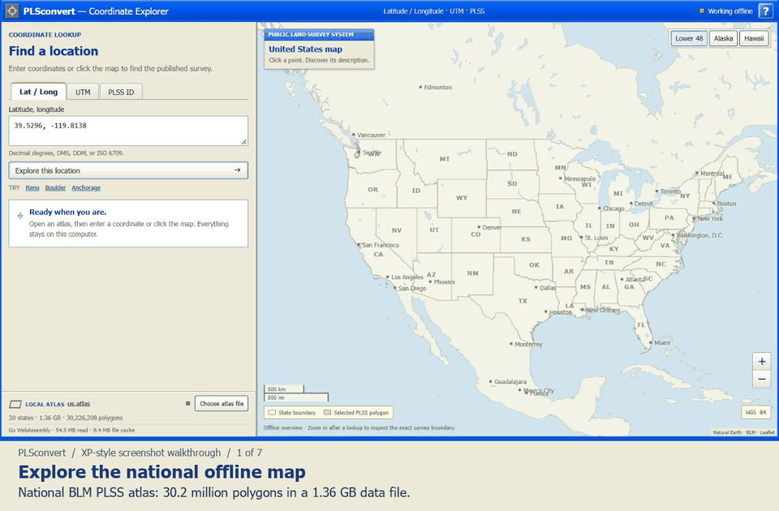
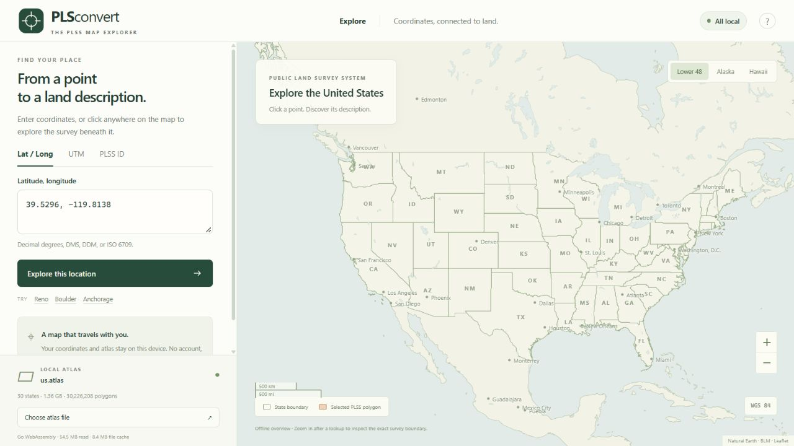
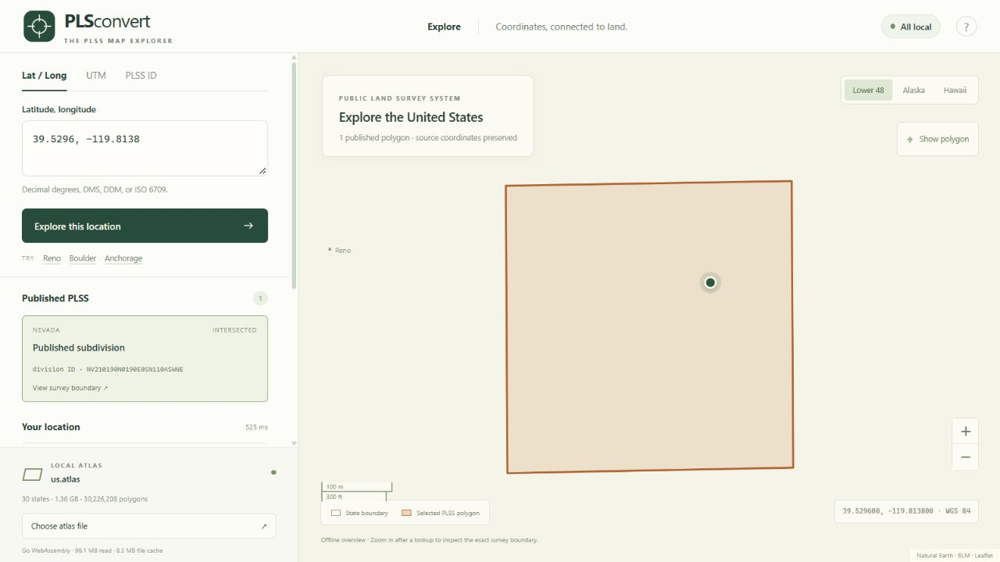
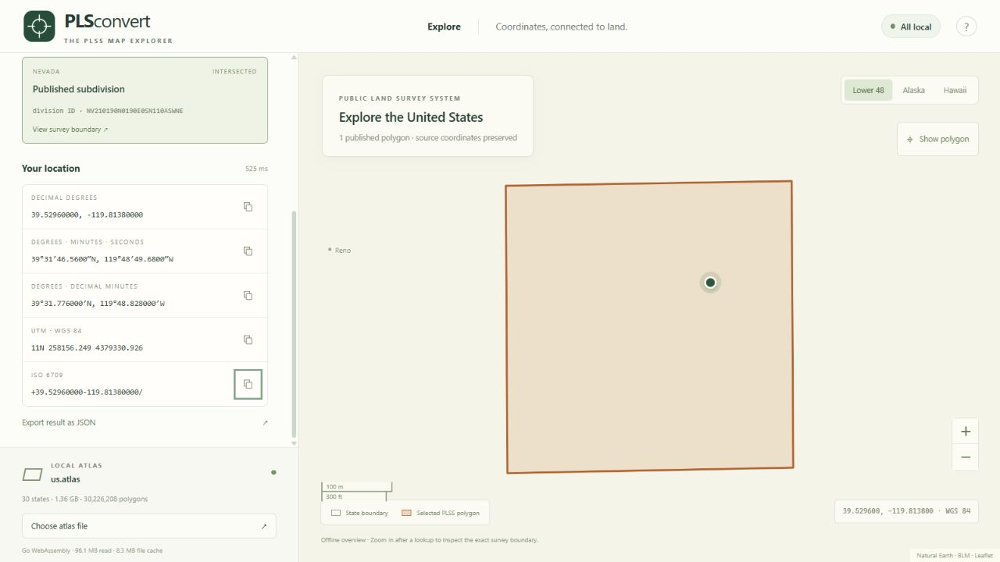
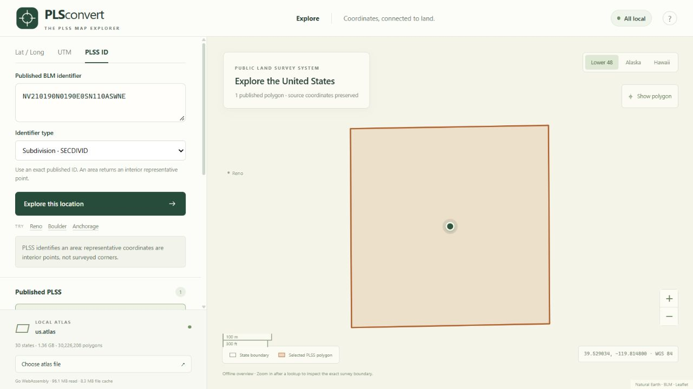
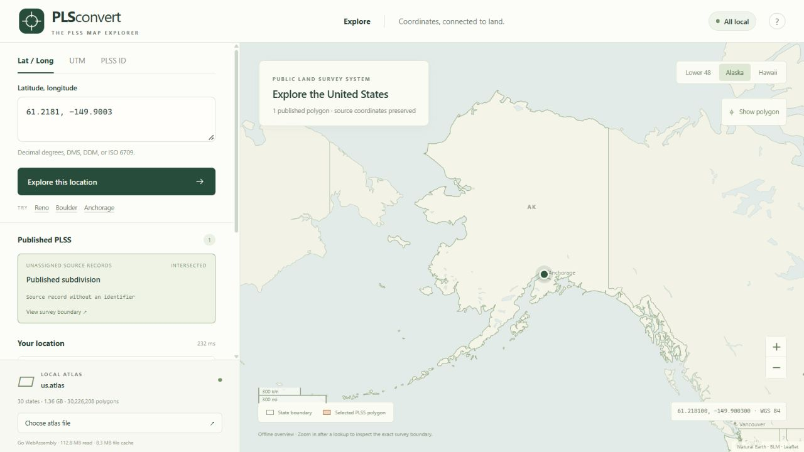
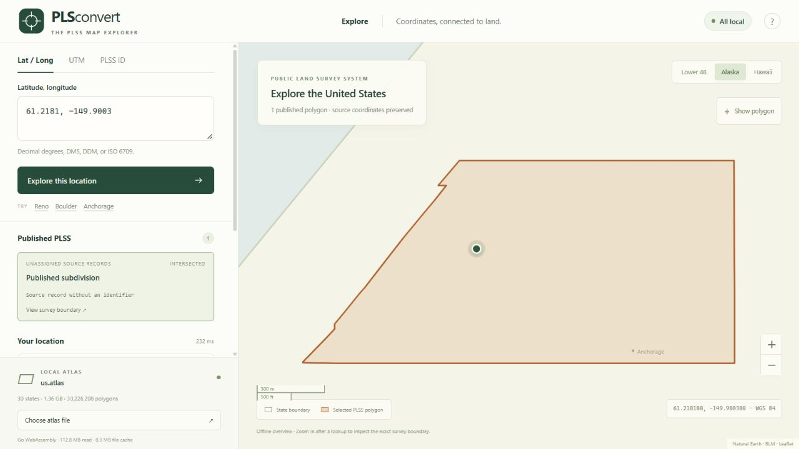
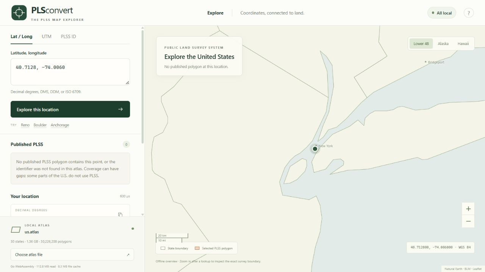

# A quick tour of the PLSS map

These are real screenshots of the working Windows app, using the national atlas
and the Go WebAssembly lookup engine. The captioned video is an edited screenshot
walkthrough, not a recording of live animation or query timing.

[Watch or download the captioned MP4](https://raw.githubusercontent.com/oudanny/PLSconvertmyPLSS/main/docs/walkthrough/plss-screenshot-walkthrough.mp4)

On a phone, turn sideways for the video or tap a screenshot to inspect the text.
The app shown here is running locally on the development laptop; these links
let you view the tour without connecting to that laptop.

## 1. Open the map

The app finds the atlas beside its executable. The national file holds
30.2 million published BLM polygons in 1.36 GB. The map background, app, and
lookup engine work offline. The geographic overview does not imply PLSS
coverage everywhere in the country.

## 2. Enter coordinates and see the matching boundary

This Reno example uses `39.5296, -119.8138`. The green marker is the requested
point; the orange outline is the containing published survey polygon. Clicking
the map also performs a lookup. The background is a small offline overview,
without streets or satellite imagery.

## 3. Copy the coordinate format you need

The same point appears in decimal degrees, degrees/minutes/seconds,
degrees/decimal minutes, UTM, and ISO 6709. Each format has a copy button.
JSON export includes the result, source provenance, and original boundary rings.

## 4. Go the other direction

Select **PLSS ID**, paste an exact BLM identifier, and choose its identifier
type. This example finds `NV210190N0190E0SN110ASWNE` and returns an interior
representative point. PLSS describes an area, so this point is not necessarily
a surveyed corner or the point used in an earlier search.

## 5. Explore Alaska too

The region controls jump between the lower 48, Alaska, and Hawaii. Geography
and lookup coverage are separate: the national atlas contains published BLM
PLSS records, including Alaska, rather than invented coverage of every location.

At `61.2181, -149.9003`, the source has a real polygon but no cadastral
identifier. The app preserves and draws it, and clearly says the identifier is
missing.

## 6. Coverage gaps are explicit

New York City has no matching PLSS polygon in this atlas. The app says so,
while latitude/longitude notation and UTM conversion still work.

For build instructions, portability details, and the current limitations, see
the [GUI guide](../map-gui.md).
